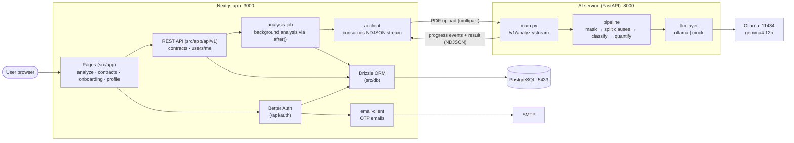
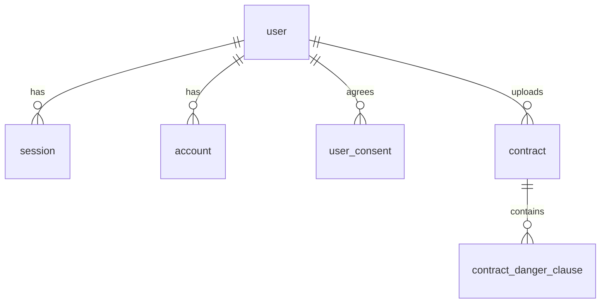

# Clean Sign

Upload a lease contract (PDF) and get its risky clauses, the expected loss per clause, and an overall contract risk score.
A Next.js app owns user and contract data, while contract analysis is handled by a separate Python (FastAPI) AI service.

## Tech Stack

| Area | Technology |
|---|---|
| Web app | Next.js 15 (App Router), React 19, Tailwind CSS 4, `@base-ui/react` |
| Auth | Better Auth (email OTP login), emails via nodemailer + React Email |
| Database | PostgreSQL 17, Drizzle ORM (`instrumentation.ts` applies migrations on server start) |
| AI service | FastAPI, pypdf, RapidOCR (scanned PDFs), LLM via Ollama (`gemma4:12b`) or mock |
| Tooling | Make, Docker Compose, uv, GitHub Actions |

## Architecture

### Overview



- Only the app server calls the AI service; it is never exposed to the browser. Set matching `AI_SERVICE_TOKEN` (app) and `INTERNAL_TOKEN` (AI service) to protect it with the `X-Internal-Token` header.
- To swap the model, change only `ai-service/app/llm/` (implement `LLMProvider` and register it in `factory.py`).

### Data Model

Schemas are split by domain under `src/db/schema/`.



The `verification` table (OTP, etc.) is used by Better Auth. For exact columns, refer to the schema files and `migrations/`.

## Directory Structure

```
src/
  app/                pages and API routes (analyze, contracts, onboarding, profile, api/v1, api/auth)
  components/ui/      shared UI components
  db/                 Drizzle connection, migration runner, schema/ (auth · user · contract)
  lib/                auth, ai-client, analysis-job, contract-queries, email-client ...
  email/              React Email templates
  instrumentation.ts  applies migrations on server start, then starts background tasks
ai-service/           Python AI service (see ai-service/README.md)
migrations/           SQL generated by Drizzle (do not edit by hand)
scripts/              new-domain.sh, clear-all.sh, scripts/ai/ (classification experiments)
docs/                 planning and design docs (requirements, API, data schema, AI analysis plan)
```

## Getting Started

One-time setup:

```bash
cp .env.example .env                 # fill in the values
ollama pull gemma4:12b               # local LLM (not needed with LLM=mock)
```

Requirements: Node 22, Docker, [uv](https://docs.astral.sh/uv/), Ollama. Dependencies (`npm install`, `uv sync`) are installed by `make run` when missing.

```bash
make run
```

## Make Commands

| Command | Description |
|---|---|
| `make run` | Start DB + Ollama + AI service + app together (Ctrl+C stops everything) |
| `make run LLM=mock` | Run with a keyword classifier instead of Ollama (fast, for UI/integration checks) |
| `make run PORT=3100` | Change the app port (`BETTER_AUTH_URL` is updated to match) |
| `make run LLM=mock MOCK_DELAY_S=2` | Add a per-clause delay to the mock classifier to check the progress screen |
| `make status` | Show whether the DB, Ollama, AI service, and app are running |
| `make stop` | Stop listeners on the app/AI service ports (DB and Ollama keep running) |
| `make stop-ollama` | Unload the model and stop `ollama serve` |
| `make check` | Type check (`tsc`) + lint (`eslint`) + AI service tests (`pytest`) |
| `make gen` | After a schema change, generate the migration SQL and apply it to the DB |
| `make domain NAME=article` | Scaffold a new domain schema (`src/db/schema/article.ts` + register in `index.ts`) |
| `make help` | Print a command summary |

Variables: `PORT` (app, default 3000) · `AI_PORT` (default 8000) · `LLM` (`ollama`\|`mock`) · `MODEL` (default `gemma4:12b`) · `MOCK_DELAY_S` · `OLLAMA_URL`
