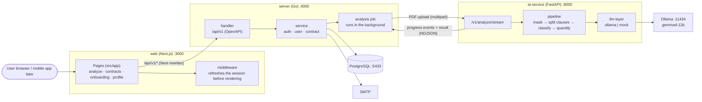
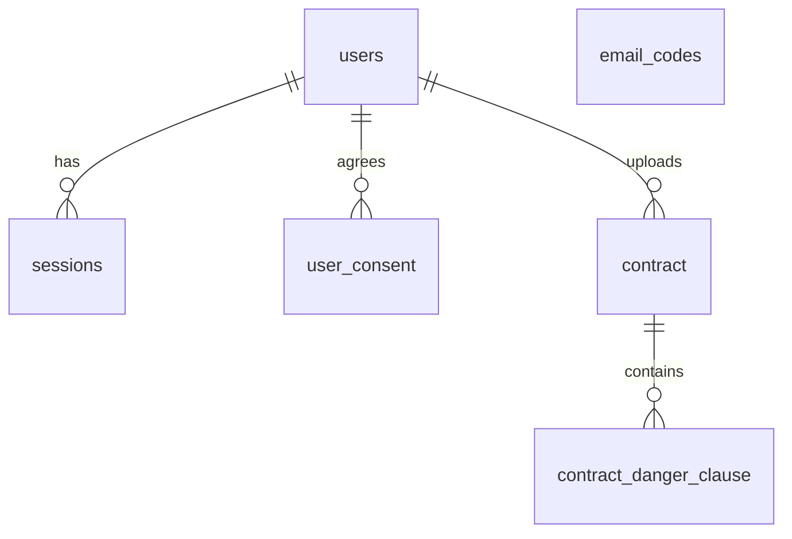

# Clean Sign

Upload a lease contract (PDF) and get its risky clauses, the expected loss per clause, and an overall contract risk score.
A Next.js **web** app renders the screens, a Go **server** owns users, contracts and the API, and contract analysis is handled by a separate Python (FastAPI) **AI service**.

## Tech Stack

| Area | Technology |
|---|---|
| Web | Next.js 15 (App Router), React 19, Tailwind CSS 4, `@base-ui/react` |
| Server | Go, Echo, oapi-codegen (OpenAPI), pgx, sqlc, goose |
| Auth | Email one-time code (6 digits) + JWT (access/refresh), mail over SMTP (Gmail works) |
| Database | PostgreSQL 17 (migrations are applied when the server starts) |
| AI service | FastAPI, pypdf, RapidOCR (scanned PDFs), LLM via Ollama (`gemma4:12b`) or mock |
| Tooling | Make, Docker Compose, uv, GitHub Actions, golangci-lint |

## Architecture

### Overview



- The browser only talks to the web app. `/api/v1/*` is proxied to the Go server by Next.js **rewrites** (`web/next.config.ts`), so cookies and CORS are not an issue. The mobile app will call the server directly with `Authorization: Bearer`.
- Only the Go server calls the AI service; it is never exposed to the browser. Set matching `AI_SERVICE_TOKEN` (server) and `INTERNAL_TOKEN` (AI service) to protect it with the `X-Internal-Token` header.
- To swap the model, change only `ai-service/app/llm/` (implement `LLMProvider` and register it in `factory.py`).
- The API contract is `server/api/openapi.yaml`. TypeScript types for the web app are generated from it (`make gen`).

### Server layers (onion)

Dependencies point inward only: `domain ← service ← (server, database, infra)`. `app` wires everything together.

```
server/internal/
  domain/      pure data and rules (standard library only): user, auth, contract
  service/     application flow; defines the ports (interfaces) it needs
  server/      HTTP handlers and middleware (inbound adapter)
  database/    sqlc queries, migrations, repositories (outbound adapter)
  infra/       ai-service client, SMTP mailer, JWT (outbound adapters)
  app/         dependency wiring and startup (the only place that sees every layer)
  shared/      small helpers: errs, authctx, clock, ids
```

The import rules are enforced in CI by golangci-lint (`depguard`, see `server/.golangci.yml`).

### Authentication

1. `POST /api/v1/auth/email/code` sends a 6-digit code (valid 5 minutes, one request per 60 seconds per email). Without SMTP settings the code is printed in the server log (local development).
2. `POST /api/v1/auth/email/confirm` checks the code and signs in (new emails are registered on the first sign-in). It returns an access token (30 min) and a refresh token (72 h, or 30 days with `rememberDevice`) in the body **and** as httpOnly cookies.
3. `POST /api/v1/auth/refresh` issues a new access token. The web middleware does this before rendering when the access token has expired; browser calls retry once on `401`.
4. `POST /api/v1/auth/logout` revokes the session (refresh tokens are stored in the `sessions` table).

### Data Model



`email_codes` holds the hashed one-time codes. The schema of record is `server/internal/database/migrations/`.

## Directory Structure

```
web/                  Next.js app (pages, components, middleware)
  src/app/            pages (analyze, contracts, onboarding, profile)
  src/lib/api/        server API client (types generated from the OpenAPI spec)
server/               Go API server (see "Server layers")
  api/                openapi.yaml and the generated server interface
  cmd/server/         entrypoint
  internal/           layers described above
ai-service/           Python AI service (see ai-service/README.md)
scripts/              new-domain.sh, scripts/ai/ (classification experiments)
docs/                 planning and design docs (requirements, API, data schema, AI analysis plan, Go migration plan)
docker-compose.yml    db, server, ai-service, web
```

## Getting Started

Requirements: Go (see `server/go.mod`), Node 22, Docker, [uv](https://docs.astral.sh/uv/), Ollama (not needed with `LLM=mock`), [sqlc](https://sqlc.dev) and [goose](https://github.com/pressly/goose) for `make gen` / `make migration`.

```bash
ollama pull gemma4:12b               # local LLM (not needed with LLM=mock)
make run                             # first run creates server/.env and web/.env from the examples
```

Open http://localhost:3000. The sign-in code shows up in the `[server]` log lines.

`make check` runs golangci-lint, which must be built with a Go version at least as new as your toolchain (`brew upgrade golangci-lint` if it complains that a file requires a newer Go version).

To run everything in containers instead: `docker compose up --build` (the AI service uses the mock classifier unless `LLM_PROVIDER=ollama` is set).

### Configuration

| File | Purpose |
|---|---|
| `server/.env` | `DATABASE_URL`, `JWT_SECRET`, `SMTP_*`, `AI_SERVICE_*`, `COOKIE_SECURE` (see `server/.env.example`) |
| `web/.env` | `SERVER_URL`, `COOKIE_SECURE` (see `web/.env.example`). `SERVER_URL` is fixed at build time for production images |
| `ai-service/.env` | model settings (see `ai-service/.env.example`) |

To send real emails with Gmail, set `SMTP_HOST=smtp.gmail.com`, `SMTP_PORT=587`, your address as `SMTP_USER`/`SMTP_FROM`, and an [app password](https://support.google.com/accounts/answer/185833) as `SMTP_PASSWORD`. Gmail limits daily sending, so use a transactional email service in production.

## Make Commands

| Command | Description |
|---|---|
| `make run` | Start DB + Ollama + AI service + server + web together (Ctrl+C stops everything) |
| `make run LLM=mock` | Run with a keyword classifier instead of Ollama (fast, for UI/integration checks) |
| `make run PORT=3100` | Change the web port |
| `make run LLM=mock MOCK_DELAY_S=2` | Add a per-clause delay to the mock classifier to check the progress screen |
| `make status` | Show whether the DB, Ollama, AI service, server, and web are running |
| `make stop` | Stop listeners on the web/server/AI ports (DB and Ollama keep running) |
| `make stop-ollama` | Unload the model and stop `ollama serve` |
| `make check` | `go vet` + `go test` + golangci-lint, `tsc` + `eslint`, `pytest` |
| `make gen` | Regenerate code from `server/api/openapi.yaml` (server interface, web types) and `server/internal/database/queries` (sqlc) |
| `make migration NAME=x` | Create a new migration file (applied automatically when the server starts) |
| `make domain NAME=article` | Scaffold a new domain (`server/internal/domain` and `service`) |
| `make db-reset` | Drop and recreate the development database |
| `make help` | Print a command summary |

Variables: `PORT` (web, default 3000) · `SERVER_PORT` (default 4000) · `AI_PORT` (default 8000) · `LLM` (`ollama`\|`mock`) · `MODEL` (default `gemma4:12b`) · `MOCK_DELAY_S` · `OLLAMA_URL`

## Adding a feature

1. Add the table in a migration (`make migration NAME=...`) and the queries in `server/internal/database/queries/`.
2. Put the rules in `domain/<name>`, the flow and ports in `service/<name>`, the repository in `database/`, and the handler in `server/`.
3. Describe the endpoint in `server/api/openapi.yaml`, then `make gen`.
4. Call it from `web/src/lib/api`.

`make domain NAME=...` creates the empty `domain` and `service` packages.
