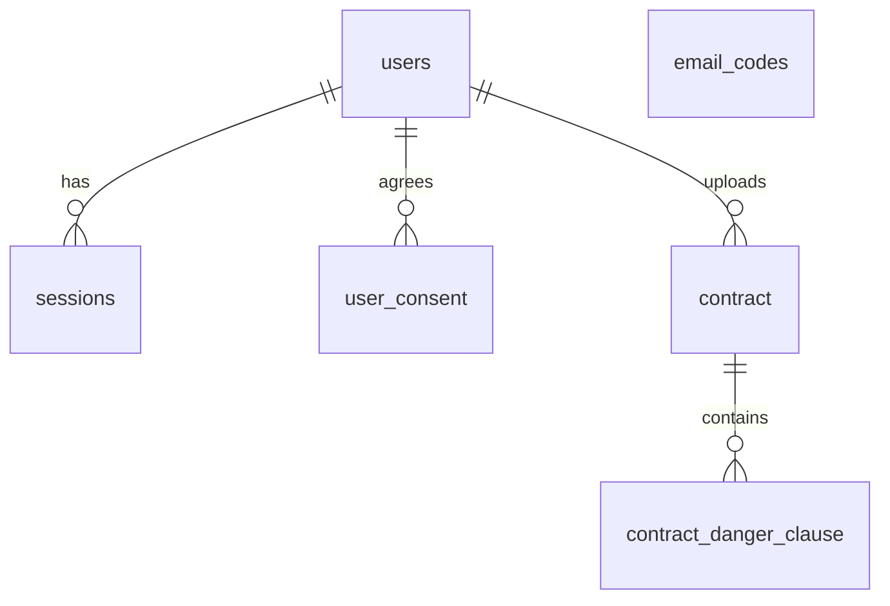

# Clean Sign

Upload a lease contract (PDF) and get its risky clauses, the expected loss per clause, and an overall contract risk score.
A Next.js **web** app renders the screens, a Go **server** owns users, contracts and the API, and contract analysis is handled by a separate Python (FastAPI) **AI service**.

## Tech Stack

| Area | Technology |
|---|---|
| Web | Next.js 15 (App Router), React 19, Tailwind CSS 4, `@base-ui/react` |
| Server | Go, Echo, oapi-codegen (OpenAPI), pgx, sqlc, goose |
| Auth | Email one-time code (6 digits) + JWT (access/refresh), mail over SMTP (Gmail works) |
| Database | PostgreSQL 17 (migrations are applied when the server starts) |
| AI service | FastAPI, pypdf, RapidOCR (scanned PDFs), LLM via Ollama (`gemma4:12b`) or mock |
| Tooling | Make, Docker Compose, uv, GitHub Actions, golangci-lint |

## Architecture

### Overview


- The browser only talks to the web app. `/api/v1/*` is proxied to the Go server by Next.js **rewrites** (`web/next.config.ts`), so cookies and CORS are not an issue. The mobile app will call the server directly with `Authorization: Bearer`.
- Only the Go server calls the AI service; it is never exposed to the browser. Set matching `AI_SERVICE_TOKEN` (server) and `INTERNAL_TOKEN` (AI service) to protect it with the `X-Internal-Token` header.
- To swap the model, change only `ai-service/app/llm/` (implement `LLMProvider` and register it in `factory.py`).
- The API contract is `server/api/openapi.yaml`. TypeScript types for the web app are generated from it (`make gen`).

### Server layers (onion)

Dependencies point inward only: `domain ← service ← (server, database, infra)`. `app` wires everything together.

```
server/internal/
  domain/      pure data and rules (standard library only): user, auth, contract
  service/     application flow; defines the ports (interfaces) it needs
  server/      HTTP handlers and middleware (inbound adapter)
  database/    sqlc queries, migrations, repositories (outbound adapter)
  infra/       ai-service client, SMTP mailer, JWT (outbound adapters)
  app/         dependency wiring and startup (the only place that sees every layer)
  shared/      small helpers: errs, authctx, clock, ids
```

The import rules are enforced in CI by golangci-lint (`depguard`, see `server/.golangci.yml`).

### Authentication

1. `POST /api/v1/auth/email/code` sends a 6-digit code (valid 5 minutes, one request per 60 seconds per email). Without SMTP settings the code is printed in the server log (local development).
2. `POST /api/v1/auth/email/confirm` checks the code and signs in (new emails are registered on the first sign-in). It returns an access token (30 min) and a refresh token (72 h, or 30 days with `rememberDevice`) in the body **and** as httpOnly cookies.
3. `POST /api/v1/auth/refresh` issues a new access token. The web middleware does this before rendering when the access token has expired; browser calls retry once on `401`.
4. `POST /api/v1/auth/logout` revokes the session (refresh tokens are stored in the `sessions` table).

### Data Model



`email_codes` holds the hashed one-time codes. The schema of record is `server/internal/database/migrations/`.

## Directory Structure

```
web/                  Next.js app (pages, components, middleware)
  src/app/            pages (analyze, contracts, onboarding, profile)
  src/lib/api/        server API client (types generated from the OpenAPI spec)
server/               Go API server (see "Server layers")
  api/                openapi.yaml and the generated server interface
  cmd/server/         entrypoint
  internal/           layers described above
ai-service/           Python AI service (see ai-service/README.md)
scripts/              new-domain.sh, scripts/ai/ (classification experiments)
docs/                 planning and design docs (requirements, API, data schema, AI analysis plan, Go migration plan)
docker-compose.yml    db, server, ai-service, web
```

## Getting Started

Requirements: Go (see `server/go.mod`), Node 22, Docker, [uv](https://docs.astral.sh/uv/), Ollama (not needed with `LLM=mock`), [sqlc](https://sqlc.dev) and [goose](https://github.com/pressly/goose) for `make gen` / `make migration`.

```bash
ollama pull gemma4:12b               # local LLM (not needed with LLM=mock)
make run                             # first run creates server/.env and web/.env from the examples
```

Open http://localhost:3000. The sign-in code shows up in the `[server]` log lines.

`make check` runs golangci-lint, which must be built with a Go version at least as new as your toolchain (`brew upgrade golangci-lint` if it complains that a file requires a newer Go version).

To run everything in containers instead: `docker compose up --build` (the AI service uses the mock classifier unless `LLM_PROVIDER=ollama` is set).

### Configuration

| File | Purpose |
|---|---|
| `server/.env` | `DATABASE_URL`, `JWT_SECRET`, `SMTP_*`, `AI_SERVICE_*`, `COOKIE_SECURE` (see `server/.env.example`) |
| `web/.env` | `SERVER_URL`, `COOKIE_SECURE` (see `web/.env.example`). `SERVER_URL` is fixed at build time for production images |
| `ai-service/.env` | model settings (see `ai-service/.env.example`) |

To send real emails with Gmail, set `SMTP_HOST=smtp.gmail.com`, `SMTP_PORT=587`, your address as `SMTP_USER`/`SMTP_FROM`, and an [app password](https://support.google.com/accounts/answer/185833) as `SMTP_PASSWORD`. Gmail limits daily sending, so use a transactional email service in production.

## Make Commands

**Run every `make` command from the repository root** (`cleansign/`). The Makefile there enters `server/`, `web/` and `ai-service/` by itself, so you never `cd` first. Running `make` inside a subfolder fails with `No rule to make target` and changes nothing.

Plain tool commands are the opposite: run them inside the folder they belong to.

| Run from | Commands |
|---|---|
| repository root | every `make ...` (below) |
| `server/` | `go test ./...`, `go vet ./...`, `go build ./...` |
| `web/` | `npm run dev`, `npm run build`, `npx tsc --noEmit`, `npx eslint src` |
| `ai-service/` | `uv run pytest -q` |

Not sure where you are? `pwd` should end with `/cleansign`. From anywhere else: `make -C /path/to/cleansign <target>`.

### Overview

| Command | What it does |
|---|---|
| `make run` | Start DB + Ollama + AI service + server + web together (Ctrl+C stops everything) |
| `make run LLM=mock` | Same, with a keyword classifier instead of Ollama (fast, for UI/integration checks) |
| `make run PORT=3100` | Change the web port |
| `make run LLM=mock MOCK_DELAY_S=2` | Add a per-clause delay to the mock classifier to check the progress screen |
| `make status` | Show whether the DB, Ollama, AI service, server, and web are running |
| `make stop` | Stop listeners on the web/server/AI ports (DB and Ollama keep running) |
| `make stop-ollama` | Unload the model and stop `ollama serve` |
| `make check` | `go vet` + `go test` + golangci-lint, `tsc` + `eslint`, `pytest` |
| `make gen` | Regenerate everything derived from a source of truth (see below) |
| `make domain NAME=article` | Scaffold the Go packages for a new domain (see below) |
| `make migration NAME=create_article` | Create the next numbered migration file (see below) |
| `make db-reset` | Drop and recreate the development database (asks first; all data is lost) |
| `make help` | Print a command summary |

Variables: `PORT` (web, default 3000) · `SERVER_PORT` (default 4000) · `AI_PORT` (default 8000) · `LLM` (`ollama`\|`mock`) · `MODEL` (default `gemma4:12b`) · `MOCK_DELAY_S` · `OLLAMA_URL`

`make gen` needs [sqlc](https://sqlc.dev) and `make migration` needs [goose](https://github.com/pressly/goose) (`brew install sqlc goose`). `make check` also runs golangci-lint when it is installed. The other generators (oapi-codegen, ifacemaker, mockgen) are fetched by `go tool`, and the web types by `npm`.

### `make gen`: regenerate derived code

Run it **whenever you change a source of truth**, then commit the generated files too (CI fails with "generated code is stale" if you forget).

| You changed | Run `make gen`? | What gets regenerated |
|---|---|---|
| `server/api/openapi.yaml` | yes | handler interface and models (`api.gen.go`), web types (`schema.d.ts`) |
| `server/internal/database/queries/*.sql` or migrations | yes | DB code (`database/sqlc/`) |
| a `service` method or a port in `ports.go` | yes | `service_interface.go` and the mocks (`*_mock_test.go`) |
| handler, domain or database implementation | no | nothing is derived from them |

A failing `go build` right after editing the spec (for example "handler does not implement `ListArticles`") is expected: it is your to-do list.

### `make domain NAME=...`: scaffold a new domain

Use it **once, when you start a new feature area** (article, booking, ...). Run it from the repository root.

```bash
make domain NAME=article
```

- `NAME`: lowercase letters and digits only, because it becomes a Go package name. Join words (`consultantavailability`, not `consultant-availability`).
- It refuses to overwrite: if `domain/article` or `service/article` already exists it stops.

It creates:

```
server/internal/domain/article/article.go          pure data and rules (standard library only)
server/internal/service/article/ports.go           the interfaces this service needs (placeholder Repository)
server/internal/service/article/service.go         the flow (placeholder Example method)
server/internal/service/article/service_interface.go   generated Service interface
server/internal/service/article/ports_mock_test.go     generated mock of the ports
```

It does **not** create a table, a migration, a handler or any API. Those come next:

1. Write the rules in `domain/article/` (with unit tests) and replace the placeholder `Repository` and `Example` in `service/article/`.
2. `make gen` after changing service methods or ports (refreshes the interface and mocks).
3. Add the table with `make migration`, the queries in `database/queries/`, the repository in `database/article.go`.
4. Add the endpoint to `server/api/openapi.yaml`, run `make gen`, implement the handler in `server/internal/server/article.go`, and wire it in `server/internal/app/app.go`.

Skip `make domain` when the feature fits an existing domain (for example another contract endpoint): just add to the existing packages.

### `make migration NAME=...`: add a migration

Use it **every time the database schema changes**. Run it from the repository root.

```bash
make migration NAME=create_article
# -> server/internal/database/migrations/00002_create_article.sql
```

- Files are numbered in order (`00001_init.sql`, `00002_...`).
- The file starts as a goose template with `-- +goose Up` and `-- +goose Down` sections. Replace the placeholder SQL with your `CREATE TABLE` / `ALTER TABLE` and the undo statements.
- You do not apply it by hand: the server applies pending migrations when it starts, so restart the server (or `make run` again) after adding one.
- **Never edit a migration that was already applied** (by you or by anyone else). Create a new one. To start over locally: `make db-reset`.
- sqlc reads the migrations as the schema, so run `make gen` afterwards if your queries use the new table.

## Issues, labels and the project board

| What | Where | Values |
|---|---|---|
| **Kind** | Issue Type (set by the issue template) | Epic, User story, Bug |
| **Area** | Labels (pick one or more) | `web`, `server`, `ai-service`, `mobile`, `infra`, `documentation` |
| **Status** | Project field | Todo, In Progress, Done |
| **Priority** | Issue field (organization) | Critical, Must, Should, Could |
| **Size** | Issue field `Effort` (organization) | S (up to half a day), M (1-2 days), L (3-5 days) |

- Create issues from the templates in `.github/ISSUE_TEMPLATE/` (User story, Epic, Bug). The template sets the Issue Type, so there are no `epic`, `user-story` or `bug` labels.
- Area labels follow the folders. An issue that touches both screens and the API gets both `web` and `server`.
- Dependency update PRs from dependabot get `dependencies` plus the area label of the folder they update.
- Priority meaning: **Critical** (drop everything: security risk or data loss), **Must** (required for the first release), **Should** (important, the release can ship without it), **Could** (nice to have, when time allows). The first release is "free analysis"; see the MoSCoW table in `docs/01-fr.md`.
- Priority and Effort are **organization issue fields**, not labels and not project-only fields. They show in the issue sidebar and can be added to any project view (view menu > Fields), so the label list stays short. Status is the only project field. Set them on the issue page or with `gh api -X POST repos/CleanSign/cleansign/issues/<n>/issue-field-values`. A story that is larger than `L` should be split or made an Epic.

## Adding a feature

The order that avoids rework: contract first, then rules, then the outside world.

| Step | What | Where | Command |
|---|---|---|---|
| 1 | Describe the endpoint, the response and the request rules | `server/api/openapi.yaml` | `make gen` |
| 2 | Table and queries | `database/migrations/`, `database/queries/` | `make migration NAME=...`, then `make gen` |
| 3 | Domain rules + unit tests | `domain/<name>/` | `make domain NAME=...` (first time) |
| 4 | Flow and ports | `service/<name>/` | `make gen` after changing methods or ports |
| 5 | Repository | `database/<name>.go` | |
| 6 | Handler and wiring | `server/internal/server/<name>.go`, `app/app.go` | |
| 7 | Web | `web/src/lib/api/`, `web/src/app/` | |
| 8 | Verify | | `make check`, `make run LLM=mock` |

Request-shape rules (required, length, allowed values) go on the spec fields with `x-oapi-codegen-extra-tags` (`validate: "required,max=254"`). `make gen` copies them onto the generated struct and the handler checks them with `validateBody(body)`. Add the user-facing Korean message for each field to `fieldMessages` in `server/internal/server/validate.go`. Rules that need state or time (cooldowns, file type) stay in `domain/`.

### Generated files (do not edit by hand)

| File | Generated from | By |
|---|---|---|
| `server/api/api.gen.go`, `web/src/lib/api/schema.d.ts` | `server/api/openapi.yaml` | oapi-codegen, openapi-typescript |
| `server/internal/database/sqlc/` | `database/queries/*.sql` + migrations | sqlc |
| `server/internal/service/*/service_interface.go` | the `service` struct's exported methods | ifacemaker |
| `server/internal/service/*/*_mock_test.go`, `server/internal/server/service_*_mock_test.go` | ports and `Service` interfaces | mockgen (gomock) |

Handlers depend on the `Service` interfaces, so handler tests run with mocks and no database (`server/internal/server/handler_test.go`). The mocks are `_test.go` files, so they are not part of the production build.
.
