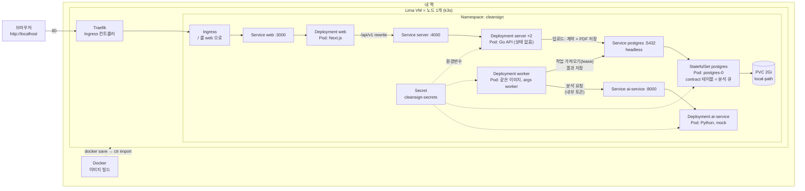
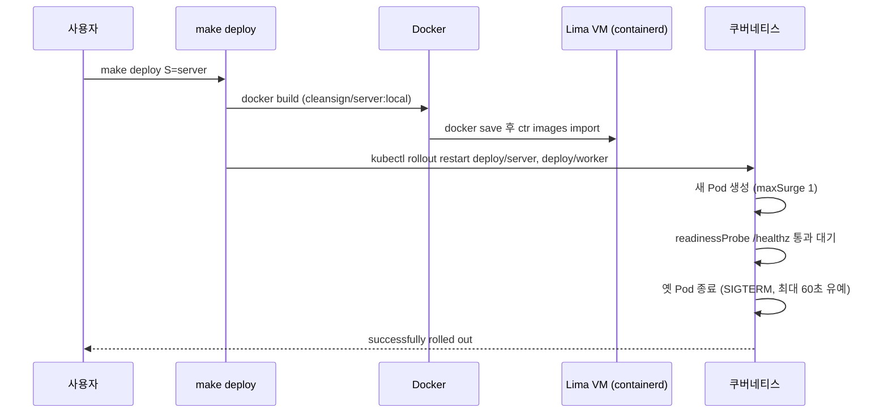
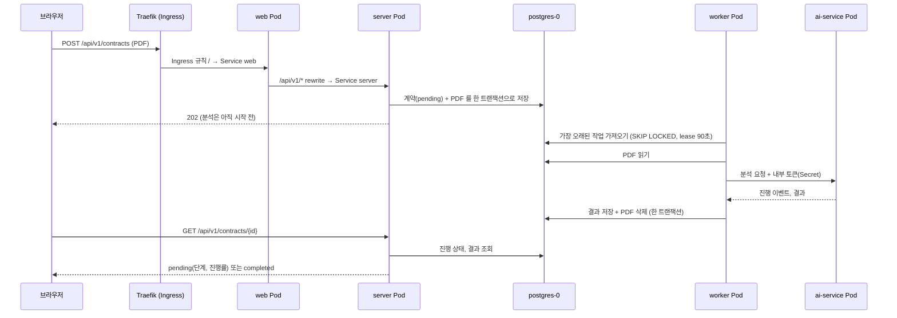
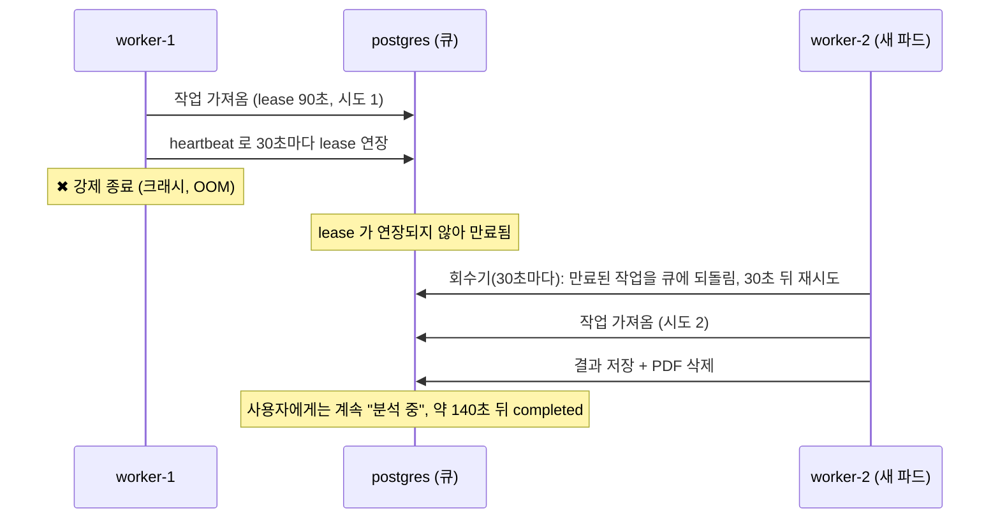

# CleanSign 배포 구조와 쿠버네티스 개념

지금 `deploy/`로 올라가 있는 것(local: Lima VM + k3s)을 그림과 개념으로 설명한다. 실행 방법은 [README.md](README.md)를 본다.

GitHub, VS Code 미리보기(Markdown Preview Mermaid Support 등), [mermaid.live](https://mermaid.live)에서 그림이 렌더링된다.

## 1. 전체 구조

server 와 worker 는 서로 직접 통신하지 않고 **DB 의 큐(`contract` 테이블)** 를 사이에 두고 만난다. 그래서 둘 중 어느 쪽이 재시작돼도 작업이 사라지지 않는다.

## 2. 배포 흐름 (`make deploy S=server`)

## 3. 요청 하나가 지나가는 길 (로그인 후 PDF 업로드)

## 3-1. worker 가 죽었을 때 (분석이 유실되지 않는 이유)

## 4. 각 요소의 역할과 쿠버네티스 개념

| 요소 | 쿠버네티스 개념 | 하는 일 |
|---|---|---|
| **Lima VM** | **노드(Node)** | 컨테이너가 실제로 도는 컴퓨터. 지금은 1대이며 컨트롤 플레인과 워커를 겸한다 |
| **k3s** | 쿠버네티스 배포판 | 가벼운 쿠버네티스. 새 컴퓨터에도 같은 것을 설치할 예정 |
| **containerd** | 컨테이너 런타임 | 노드 안에서 이미지를 받고 컨테이너를 실행한다. `ctr images import`로 이미지를 넣는 대상 |
| **Namespace `cleansign`** | **네임스페이스** | 리소스를 묶는 폴더. `make down` 한 줄로 전부 정리된다 |
| **Pod** | **파드** | 컨테이너를 감싸는 최소 실행 단위. 여기서는 파드 1개에 컨테이너 1개 |
| **Deployment** (web, server, worker, ai-service) | **디플로이먼트** | "이 이미지로 파드를 몇 개 띄워라"는 선언. 파드가 죽으면 다시 살리고 새 버전으로 교체한다. 내부적으로 ReplicaSet이 파드 개수를 유지한다 |
| **worker** (Deployment, `args: ["worker"]`) | 배치(백그라운드) 처리 | 큐에서 일감을 가져가 처리하는 프로세스. HTTP API 가 없어서 Service 가 없고, 같은 이미지를 다른 명령으로 실행한다. 개수를 늘리면 처리량이 늘고, 하나가 죽어도 다른 것이 이어받는다 |
| **replicas: 2** (server) | **복제본** | 같은 파드를 2개 띄운다. server 는 상태가 없어서 가능하다(분석은 worker 가 하므로). 하나를 교체하는 동안 다른 하나가 요청을 받는다 |
| **StatefulSet** (postgres) | **스테이트풀셋** | 상태가 있는 앱용. 파드 이름이 고정(`postgres-0`)되고 같은 디스크를 다시 붙잡는다 |
| **PVC** + local-path | **PersistentVolumeClaim**, **StorageClass** | "디스크 2Gi 주세요"라는 요청. k3s의 local-path가 VM 디스크에 만들어 준다. 파드를 지워도 데이터가 남는다 |
| **Service** | **서비스** | 파드는 교체될 때마다 IP가 바뀌므로 `server:4000`처럼 **고정된 이름**으로 부르게 해 준다. 클러스터 안에서만 접근 가능(ClusterIP). postgres는 headless(`clusterIP: None`) |
| **Ingress** | **인그레스** | 밖에서 들어오는 HTTP 요청을 어느 Service로 보낼지 정하는 **규칙** (`/` → web) |
| **Traefik** | **Ingress 컨트롤러** | 그 규칙을 실제로 실행하는 프로그램. k3s에 기본 포함 |
| **Secret** `cleansign-secrets` | **시크릿** | DB 비밀번호, JWT 비밀키, 내부 토큰. YAML에 직접 쓰지 않고 `secretKeyRef`로 파드 환경변수에 주입한다 |
| **readinessProbe / livenessProbe** | **프로브** | readiness는 "트래픽을 받을 준비가 됐나"(통과 전엔 Service가 보내지 않음), liveness는 "살아 있나"(계속 실패하면 재시작) |
| **requests / limits** | **리소스 요청·상한** | requests는 스케줄러가 보장할 최소량, limits는 넘으면 안 되는 상한. 메모리를 넘으면 강제 종료(`OOMKilled`) |
| **RollingUpdate** (server) | **배포 전략** | 새 파드가 Ready가 된 뒤 옛 파드를 내려서 교체 중 중단을 줄인다 |
| **terminationGracePeriodSeconds: 60** (worker) | **종료 유예** | 종료 신호(SIGTERM) 후 강제 종료까지 기다려 주는 시간. worker 가 진행 중인 분석을 최대 30초 기다리고 끝내거나 큐에 되돌리는 데 필요하다 |
| **Kustomize** (`base` + `overlays/local`) | **구성 관리** | 공통 YAML(base)에 환경별 차이(이미지 태그, Secret)를 덧씌운다. 나중에 `overlays/prod`만 추가하면 된다 |
| **`make forward`** | **port-forward** | 맥의 포트(3000, 4000, 8000, 5433)를 파드에 임시 터널로 연결한다. Ingress를 거치지 않는 디버깅용 |

## 5. 직접 눈으로 확인하는 방법

k9s(`KUBECONFIG=$HOME/.lima/k3s-1/copied-from-guest/kubeconfig.yaml k9s -n cleansign`)에서 `:` 뒤에 입력한다.

| 입력 | 보이는 것 |
|---|---|
| `:deploy` | Deployment 목록 |
| `:rs` | ReplicaSet. 배포할 때마다 하나씩 생기고 옛 것은 0개로 남는다 |
| `:pods` | 파드. 삭제(`ctrl-d`)하면 자동으로 다시 생긴다 |
| `:svc` / `:ep` | Service와 그 뒤의 실제 파드 주소(Endpoints) |
| `:pvc` | 디스크. 파드를 지워도 남는다 |
| `:ing` | Ingress 규칙 |
| `:secrets` | Secret (값은 base64로 보임) |

## 6. 아직 그림에 없는 것

CI/CD, 레지스트리(GHCR)를 쓰는 배포, 도메인과 TLS, 멀티 노드(물리 분리), 모니터링(큐 길이, 재시도·실패율). 자세한 한계는 [README.md](README.md#알려진-한계)를 본다.
