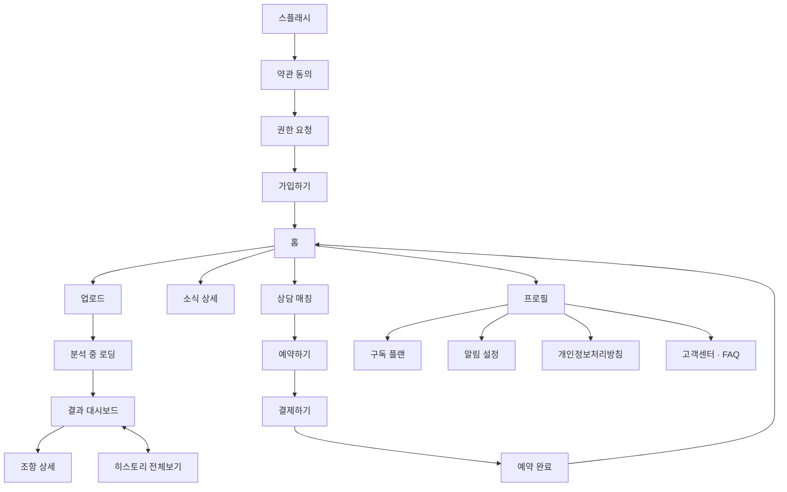

# 2. API 설계 + UI 설계

[`01-fr.md`](./01-fr.md)의 요구사항을 화면 흐름과 REST API로 구체화한 문서입니다.

> **구현 현황 (2026-10)**: 인증, 계약서 분석, 히스토리, 약관 동의, 내 정보는 구현됐고 **소식, 전문가 상담·예약, 구독·결제, 알림 설정은 아직 없습니다**(아래 표에서 `미구현`으로 표시). API의 **정확한 계약은 `server/api/openapi.yaml`** 이 기준이고, 이 문서는 설계 의도와 화면 흐름을 설명합니다. 구현된 API는 경로와 응답 모양이 이 문서와 같습니다. 단, 인증은 Better Auth가 아니라 server가 직접 처리합니다(2-2-1 가입하기).

---

## 2-1. UI 설계 — 화면 흐름

홈이 허브이고, 홈에서 업로드/소식/상담매칭/프로필/히스토리 다섯 갈래로 갈라집니다.



- 상담 매칭 → 예약 → 결제 → 완료 흐름은 김민준 변호사 / 이서연 공인중개사 / 박지훈 변호사 3명이 동일한 패턴으로 반복됨 (`consultantId`만 다름)
- FAQ는 DB/API 없이 클라이언트에 하드코딩된 정적 콘텐츠
- 화면별 시각 자료: [화면 설계 + API 캔버스](https://claude.ai/artifact/8WdxGbu3DPzr7r7tqGyFTk)

---

## 2-2. API 설계

### 리소스 개요

| 리소스 | 경로 | 비고 |
|---|---|---|
| 인증 | `/api/v1/auth/*` | 이메일 인증코드 + JWT. server가 직접 구현 (구현됨) |
| 내 계정 | `/api/v1/users/me/*` | 프로필·동의는 구현됨. 알림설정·구독은 미구현 |
| 구독 카탈로그 | `/api/v1/subscriptions/plans` | 유저 개인 상태가 아니라 공개 가격표라 별도 리소스 (미구현) |
| 계약서 분석 | `/api/v1/contracts/*` | 구현됨 |
| 소식 | `/api/v1/articles/*` | 미구현 (홈의 소식 3건은 화면에 하드코딩) |
| 전문가 상담 | `/api/v1/consultants/*`, `/api/v1/bookings/*` | 미구현 |
| 고객센터 | 없음 | FAQ는 DB/API 없이 클라이언트에 하드코딩 |

**공통 규칙 (구현됨)**

- 인증: `Authorization: Bearer <access 토큰>` 또는 httpOnly 쿠키(`cs_access`). web은 쿠키, 모바일은 Bearer를 쓴다. access 토큰은 30분, refresh 토큰은 72시간(기기 기억 시 30일)이다.
- 오류 응답은 항상 `{ "error": "<사용자에게 보여 줄 메시지>" }`다. 인증이 필요한데 없거나 만료됐으면 `401 unauthorized`, 남의 리소스는 존재 여부를 숨기려고 `404 not found`다.
- web은 `/api/v1/*`을 Next rewrites로 server에 그대로 전달한다. 그래서 브라우저에서는 같은 출처다.

### 전역 (어디서든)

| 액션 | API |
|---|---|
| 로그아웃 | `POST /api/v1/auth/logout` (세션을 폐기하고 쿠키를 지운다) |

### 2-2-1. 화면 전환 시 호출 API

사용자 행동에 의해 **다음 화면으로 넘어가면서** 실행되는 API입니다.

#### 온보딩 — 스플래시 → 약관 동의 → 권한 요청 → 가입하기 → 홈

| 전환 | API | 비고 |
|---|---|---|
| 스플래시 → 약관 동의 | 없음 | 정적 화면 |
| 약관 동의 → 권한 요청 | 없음 | 동의 체크 상태는 클라이언트에 보관, 가입 시 함께 전송 |
| 권한 요청 → 가입하기 | 없음 | OS/브라우저 네이티브 권한 요청. **모바일**: 카메라(필수)·사진보관함(선택)·알림(선택). **웹**: 파일 업로드(필수)·알림(선택) — 웹은 카메라 불필요 |

**가입하기 → 홈** ("인증코드 받기" → "인증하고 시작하기")

```
POST /api/v1/auth/email/code
In:  { email }
Out: { retryAfterSeconds }                 // 6자리 코드를 메일로 보낸다. 5분 유효, 같은 이메일은 60초 뒤에 다시 요청 가능 (429 + Retry-After)

POST /api/v1/auth/email/confirm
In:  { email, code, rememberDevice? }
Out: { accessToken, refreshToken, accessExpiresAt, refreshExpiresAt }
     // 처음 보는 이메일이면 여기서 가입된다. 토큰은 본문과 httpOnly 쿠키 양쪽으로 내려간다. 틀린 코드는 5번까지, 코드는 한 번만 쓸 수 있다

POST /api/v1/auth/refresh                  // refresh 토큰(쿠키 또는 본문)으로 새 access 토큰을 받는다. refresh 토큰은 바뀌지 않는다
POST /api/v1/auth/logout                   // → 204

POST /api/v1/users/me/consents             ← 로그인 직후
In:  { terms: bool, privacy: bool, marketing: bool }
Out: 201 { id, userId, terms, privacy, marketing, createdAt }
     // terms·privacy가 boolean이 아니거나 하나라도 false면 400
```

로그인 흐름은 [`08-go-server-changes.md`](./08-go-server-changes.md)의 4~5장에 그림으로 정리돼 있습니다. 메일은 SMTP로 보내며, 설정이 없으면 server 로그에 코드가 남습니다(개발용).

#### 계약서 분석 — 홈에서 분기

**업로드 → 분석 중 로딩 → 결과 대시보드** (파일 선택/촬영 완료 시)

```
POST /api/v1/contracts
In:  multipart/form-data { file }
Out: 202 { id, status: "pending" }          // 즉시 응답, 분석은 응답 이후 이어서 실행

GET /api/v1/contracts/{id}                   // 상태 확인 겸 결과 조회 (대시보드 진입 API와 동일)
Out: { id, status, progress, error, riskItems, lossAmount, flow, ... }
     status: pending | completed | failed
     pending  → progress { stage: reading | ocr | splitting | classifying | scoring, done, total }
     failed   → error (사용자에게 보여 줄 메시지)
     completed → riskItems 등 결과
```

> **결정 변경 (2026-10-06):** 이전에는 "분석이 5초 내외로 끝나므로 동기 응답, 폴링 없음"으로 설계했다. 실측 결과 로컬 모델(`gemma4:12b`)은 조항 하나에 약 6초, 계약서 하나에 30초~1분이 걸려서 5초 전제가 깨졌다. 요청 하나를 그 시간 동안 열어 두면 새로고침·화면 이동 시 결과를 잃고, 프록시 타임아웃에도 걸린다. 그래서 `contract.status`(pending/completed/failed)를 실제로 사용하는 비동기 방식으로 바꿨다.

- 업로드 화면은 `POST` 직후 결과 화면(`/contracts/{id}`)으로 이동한다. 이 화면이 `pending`이면 1.5초 간격으로 `GET /contracts/{id}`를 호출해 서버가 알려 주는 **실제 처리 단계**(`progress`)를 보여 주고, `completed`/`failed`가 되면 결과 또는 오류 화면을 그린다. 클라이언트가 지어낸 애니메이션은 쓰지 않는다.
- 분석 도중 화면을 나가거나 새로고침해도 분석은 계속된다. 홈의 최근 분석에 "분석 중"으로 보이고 다시 열 수 있다.
- 분석 작업은 **server(Go) 프로세스의 백그라운드 작업**으로 응답 이후 실행되며, ai-service의 `/v1/analyze/stream`(NDJSON)에서 단계를 받아 DB(`contract.progress`)에 기록한다. 서버를 정상 종료할 때는 진행 중인 분석을 기다렸다가 끝낸다. 서버가 갑자기 죽으면 작업이 사라지므로, `pending`이 15분을 넘으면 조회 시점에, 그리고 1분마다 도는 청소 작업이 `failed`("분석이 중단됐어요")로 바꾼다. 작업이 사라지지 않게 하는 방법은 [`03-high-level-design.md`](./03-high-level-design.md) 3-2(작업 큐)를 보세요.
- 읽을 수 없는 파일(스캔본 등)과 서버 오류는 모두 `failed` + `error`로 돌아온다. 이전의 즉시 4xx 응답은 형식(PDF가 아님, 10MB 초과)에만 남는다.

**결과 대시보드 → 조항 상세** (솔루션 카드 클릭)

```
GET /api/v1/contracts/{id}/clauses/{clauseId}
Out: { id, contractId, clauseType, original, lossAmount, severity, confidence, reason, lawReference[], safeText }
```

`severity`(high/medium/low)는 법적으로 얼마나 나쁜가가 아니라 **예상 손실이 보증금에 비해 얼마나 큰가**다. 화면에서는 "손실 큼/보통/작음" 칩으로 쓰고, 작은 쪽을 초록(안전)으로 칠하지 않는다.

**결과 대시보드 ⇄ 히스토리**

- 대시보드 "전체보기" → 히스토리(`/contracts`): 화면 전환 자체는 API 없음 (히스토리 진입 시 자체 조회, 2-2-2 표 참고)
- 히스토리 목록: `GET /api/v1/contracts?page=1&limit=20` → `{ items[{ id, status, fileName, createdAt, lossAmount, riskCount, error }], page, total, hasMore }` (최신순, 실패한 분석도 포함 — 지우거나 다시 올릴 수 있어야 하므로). `page`는 1 이상(잘못된 값은 1), `limit`은 1~50(없거나 0이면 20, 50 초과는 50). `riskCount`는 완료된 분석에서만, `error`는 실패한 분석에서만 값이 있다.
- 홈의 "최근 분석": `GET /api/v1/contracts?status=active&limit=3` — 완료·진행 중만, **실패는 제외**한다(홈에서는 실패를 보여 주지 않는다).
- 삭제: `DELETE /api/v1/contracts/{id}` → `204` (본인 것만, 조항은 함께 삭제, 없거나 남의 것은 `404`). 분석 중에 지우면 진행 중인 분석 결과는 버려진다. 화면에서는 확인창을 거친다.
- 히스토리 항목 클릭 → 대시보드: 아래 `GET /api/v1/contracts/{id}`(대시보드 진입 API)와 동일

#### 소식 — 홈에서 분기 (미구현)

홈 → 소식 상세: 화면 전환 자체는 API 없음 (소식 상세 진입 시 자체 조회, 2-2-2 표 참고)

#### 전문가 상담 — 홈에서 분기 (미구현)

**상담 매칭 → 예약하기** ("상담 신청하기" 클릭): API 없음, consultantId만 다음 화면으로 전달

**예약하기 → 결제하기** ("결제하기" 클릭)

```
POST /api/v1/bookings
In:  { consultantId, date, time, note? }
Out: { id, amount }
```

**결제하기 → 예약 완료** ("N원 결제하기" 클릭)

```
POST /api/v1/bookings/{id}/payment
In:  { method: "card" | "kakaopay" | "naverpay" }
Out: { status: "paid" }
```

**예약 완료 → 홈**: API 없음 ("홈으로" 버튼)

> 김민준 변호사 / 이서연 공인중개사 / 박지훈 변호사, 3명 모두 동일한 패턴이 반복됩니다. `consultantId`만 다릅니다.

#### 계정 — 홈 → 프로필에서 4갈래 분기

홈 → 프로필: API 없음

**프로필 → 구독 플랜** (플랜 "선택하기", 미구현)

```
PATCH /api/v1/users/me/subscription
In:  { planId, billingCycle: "monthly" | "yearly" }
```

**프로필 → 알림 설정** (토글 클릭마다, 미구현)

```
PATCH /api/v1/users/me/notification-settings
In:  { key: "analysis" | "booking" | "marketing" | "updates", value: bool }
```

**프로필 → 개인정보처리방침**: API 없음 (정적 콘텐츠)

**프로필 → 고객센터**: API 없음 (FAQ는 DB/API 없이 클라이언트에 하드코딩된 정적 콘텐츠)

### 2-2-2. 화면 진입 시 호출 API (On-load)

**전환 경로와 무관하게**, 해당 화면에 도착하면 항상 호출되는 API입니다. (예: 대시보드는 업로드를 막 끝내고 오든 히스토리에서 오든 항상 `GET /api/v1/contracts/{id}`를 호출)

| # | 화면 | API | Out |
|---|---|---|---|
| 0 | 스플래시 | 없음 | — |
| 1 | 약관 동의 | 없음 | — |
| 2 | 권한 요청 | 없음 | — |
| 3 | 가입하기 | 없음 | — |
| 4 | 홈 | `GET /api/v1/users/me` | id, name, email, emailVerified (plan·usage는 미구현) |
| | | `GET /api/v1/contracts?status=active&limit=3` | recent[] (실패 제외) |
| | | `GET /api/v1/articles?limit=3` | articles[] (미구현, 화면에 하드코딩) |
| 5 | 업로드 | 없음 | — |
| 6 | 분석 중 로딩 | `GET /api/v1/contracts/{id}` (1.5초 폴링) | status, progress |
| 7 | 결과 대시보드 | `GET /api/v1/contracts/{id}` | riskItems, lossAmount, flow |
| 8 | 조항 상세 | `GET /api/v1/contracts/{id}/clauses/{clauseId}` | original, loss, safeText |
| 9 | 히스토리 전체보기 | `GET /api/v1/contracts?page=` | items[], hasMore |
| 10 | 프로필 | `GET /api/v1/users/me` | email (plan은 미구현. "무료 플랜" 표시는 하드코딩) |
| 11 | 구독 플랜 | `GET /api/v1/subscriptions/plans` | plans[] |
| | | `GET /api/v1/users/me/subscription` | current |
| 12 | 소식 상세 | `GET /api/v1/articles/{id}` | title, body |
| 13 | 전문가 상담 매칭 | `GET /api/v1/consultants?type=` | list[] |
| 14 | 예약하기 (김민준) | `GET /api/v1/consultants/{id}/availability?date=` | slots[] |
| 15 | 결제하기 (김민준) | `GET /api/v1/bookings/{id}` | summary |
| 16 | 예약 완료 (김민준) | `GET /api/v1/bookings/{id}` | status, summary |
| 17 | 예약하기 (이서연) | `GET /api/v1/consultants/{id}/availability?date=` | slots[] |
| 18 | 결제하기 (이서연) | `GET /api/v1/bookings/{id}` | summary |
| 19 | 예약 완료 (이서연) | `GET /api/v1/bookings/{id}` | status, summary |
| 20 | 예약하기 (박지훈) | `GET /api/v1/consultants/{id}/availability?date=` | slots[] |
| 21 | 결제하기 (박지훈) | `GET /api/v1/bookings/{id}` | summary |
| 22 | 예약 완료 (박지훈) | `GET /api/v1/bookings/{id}` | status, summary |
| 23 | 컴포넌트 라이브러리 | 없음 | 참조 문서, 플로우 밖 |
| 24 | 알림 설정 | `GET /api/v1/users/me/notification-settings` | flags |
| 25 | 개인정보처리방침 | 없음 | 정적 콘텐츠 |
| 26 | 고객센터 | 없음 | 클라이언트 하드코딩 (DB/API 없음) |

### 2-2-3. 분기 구조 요약

```
스플래시 → 약관동의 → 권한요청 → 가입하기 → 홈
                                          │
        ┌───────────┬───────────┬───────┴───────┬──────────────┐
        ▼           ▼           ▼               ▼              ▼
     업로드       소식상세    상담매칭          프로필      (히스토리 항목 클릭 시
        │                       │                │          대시보드로 복귀)
        ▼                       ▼           ┌────┼────┬──────┐
      로딩                  예약→결제→완료   ▼    ▼    ▼      ▼
   (API 없음)               (×3, 상담사만)  구독  알림 개인정보 고객센터
        │                     └──→ 홈
        ▼
     대시보드 ⇄ 히스토리
        │
        ▼
     조항상세
```

---

## 다음

- 경로와 페이로드는 초안이며, 데이터 스키마와 함께 확정을 권장합니다 → [`04-data-schema-modeling.md`](./04-data-schema-modeling.md)
- 하이레벨 아키텍처: [`03-high-level-design.md`](./03-high-level-design.md)
- 실제 API 계약(명세): `server/api/openapi.yaml`
