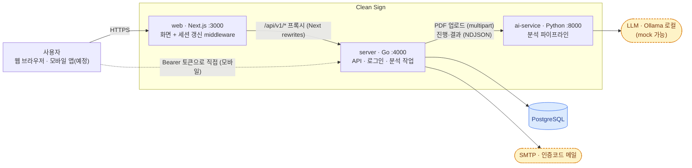
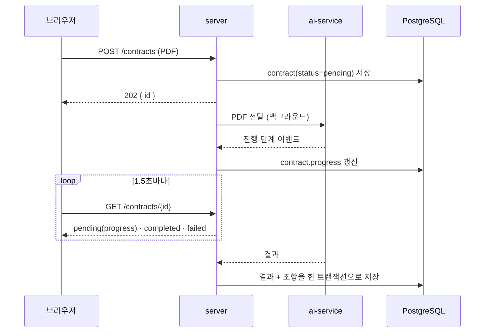
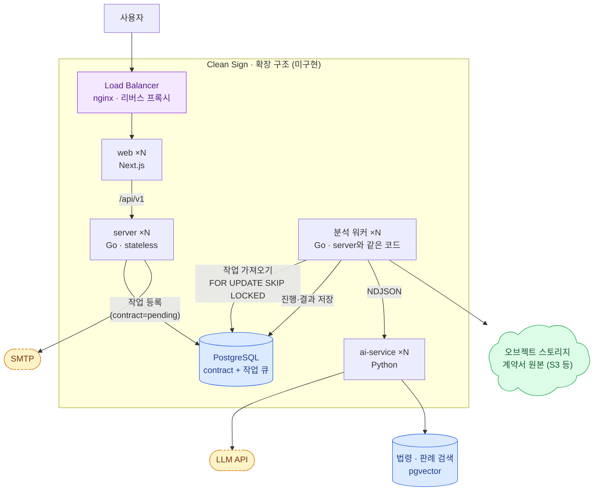

# 3. High Level Design

[`02-api-ui-design.md`](./02-api-ui-design.md)의 API 표면을 실제로 서빙하기 위한 시스템 경계와 인프라 구조입니다.

- **3-1은 지금 구현된 구조**, **3-2는 앞으로의 확장 방향**(미구현)입니다. 두 장을 섞지 않도록 구현 여부를 표시했습니다.
- 구조가 이렇게 된 과정과 코드 레벨의 계층은 [`07-go-server-migration-plan.md`](./07-go-server-migration-plan.md), [`08-go-server-changes.md`](./08-go-server-changes.md)를 보세요.
- 설계 당시의 인터랙티브 캔버스(https://claude.ai/artifact/PMWpV9YT1qWXAdHPAqSaQF)는 "Next.js 한 덩어리 + Kafka RPC" 기준이라 현재 구조와 다릅니다.

> **2026-10 개정**: 이전 판은 `Next.js App` 안에 화면·API·Better Auth·분석 파이프라인을 두고, 분석은 Kafka RPC로 **동기 응답**을 만드는 구조였습니다. 현재는 (1) web / server(Go) / ai-service(Python)로 나뉘었고, (2) 로그인은 이메일 인증코드 + JWT를 server가 직접 처리하며, (3) 분석은 **비동기**(202 즉시 응답 + 상태 폴링)입니다. 동기 응답을 폐기한 이유는 02-2-1의 "결정 변경 (2026-10-06)"을 보세요.

---

## 3-1. 현재 구조 (구현됨) — 시스템 경계 + 외부 의존성

| 구성요소 | 책임 | 비고 |
|---|---|---|
| web | 화면(서버 컴포넌트), 로그인 토큰 갱신 | API 라우트와 DB 접근 없음. `/api/v1/*`는 Next가 server로 그대로 전달 |
| server | REST API(`server/api/openapi.yaml`), 이메일 코드 로그인·JWT, 계약서 저장·조회, 백그라운드 분석 | 어니언 구조(domain ← service ← server·database·infra). 모바일이 붙을 직접 접점 |
| ai-service | PDF 텍스트 추출(OCR 포함) → 마스킹 → 조항 분리 → 분류 → 정량화 | server만 호출한다(`X-Internal-Token`). 브라우저에 노출하지 않음. 모델 교체는 `ai-service/app/llm/`만 |
| PostgreSQL | 사용자·세션·인증코드·동의·계약서·조항 | 마이그레이션은 server가 시작할 때 적용(goose) |
| SMTP | 로그인 인증코드 메일 | 미설정이면 server 로그에 코드를 남긴다(개발용). Gmail은 일일 발송 한도가 있어 운영에는 전용 서비스 권장 |

**지금 없는 것 (설계 당시 그림에는 있었음)**: 오브젝트 스토리지(원본은 저장하지 않음, `contract.file_key`는 비어 있음), 법령·판례 벡터DB와 법령 MCP(RAG), 결제 PG, 로드밸런서.

### 분석 요청의 흐름

- 분석 작업은 server 프로세스 안에서 돈다. 정상 종료할 때는 진행 중인 분석을 기다렸다가 끝낸다.
- **한계**: server가 갑자기 죽으면 진행 중이던 작업이 사라진다. 그래서 15분이 넘은 `pending`은 조회할 때, 그리고 1분마다 도는 청소 작업이 `failed`("분석이 중단됐어요")로 바꾼다. 이 한계를 근본적으로 없애는 것이 3-2의 작업 큐다.
- server 인스턴스를 여러 개 두는 것은 가능하지만(상태는 DB에 있음), 분석 작업은 요청을 받은 인스턴스에 묶여 있다.

---

## 3-2. 확장 방향 (미구현) — LB + server ×N + 작업 큐 + 분석 워커

지금 구조에서 병목과 약점은 두 가지입니다. ① 분석이 오래 걸려(조항당 수 초, 계약서당 30초~1분) 요청을 받은 server 프로세스에 묶이고 재시작에 약하다. ② ai-service가 느린 모델에 묶여 동시 분석 수가 제한된다. 이를 풀기 위한 방향입니다.

**클라이언트가 보는 API는 지금과 같습니다.** `POST /contracts`는 계속 202를 돌려주고 화면은 `GET /contracts/{id}`를 폴링합니다. 달라지는 것은 "분석을 누가 실행하는가"뿐입니다.

| 항목 | 지금 | 확장 |
|---|---|---|
| 분석 실행 | 요청을 받은 server의 goroutine | 별도 워커가 DB 큐에서 가져와 실행 |
| 서버 재시작 | 진행 중이던 분석이 사라지고 `failed`로 정리 | 워커가 작업을 다시 가져가 이어서 실행 |
| 파일 전달 | server 메모리에 들고 있다가 ai-service로 전송 | 오브젝트 스토리지에 올리고 키로 전달 (워커가 읽음) |
| 장애 처리 | 실패 메시지를 저장하고 끝 | 시도 횟수와 임대 시간(lease)으로 재시도, 한도를 넘으면 `failed` |

**왜 Kafka가 아니라 DB 큐인가**: 이전 판은 Kafka RPC를 상정했지만, 지금 규모(수십 건/일 수준 가정)에서 Kafka는 운영 비용이 크고, 이미 쓰는 PostgreSQL의 `SELECT ... FOR UPDATE SKIP LOCKED`로 같은 일을 별도 인프라 없이 할 수 있습니다. 작업이 늘어 DB 큐가 병목이 되면 그때 Kafka나 전용 큐(SQS, Redis 등)로 바꿉니다. 워커는 "큐에서 가져와 ai-service를 호출한다"는 인터페이스 뒤에 두면 큐 구현만 교체됩니다.

**다음 열어둔 질문**
- 재시도·타임아웃 정책: 시도 횟수 한도, lease 길이, 멈춘 작업을 되살리는 방법(DLQ 대체).
- 오브젝트 스토리지 도입 시점과 원본 보관 기간(개인정보처리방침과 연결).
- 법령·판례 RAG(pgvector)를 ai-service 안에 둘지 별도 서비스로 둘지는 [`06-ai-analysis-plan.md`](./06-ai-analysis-plan.md) 6-7을 보세요.

---

## 다음

- 데이터 스키마: [`04-data-schema-modeling.md`](./04-data-schema-modeling.md)
