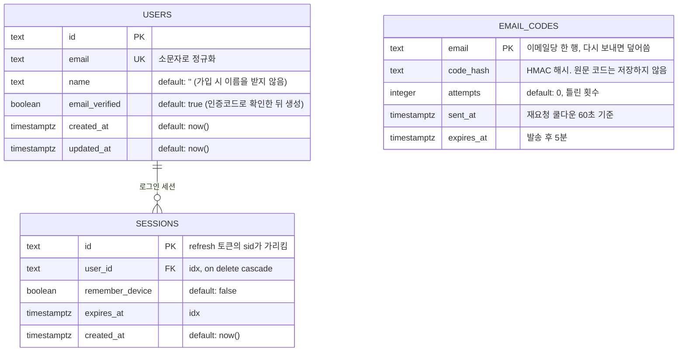
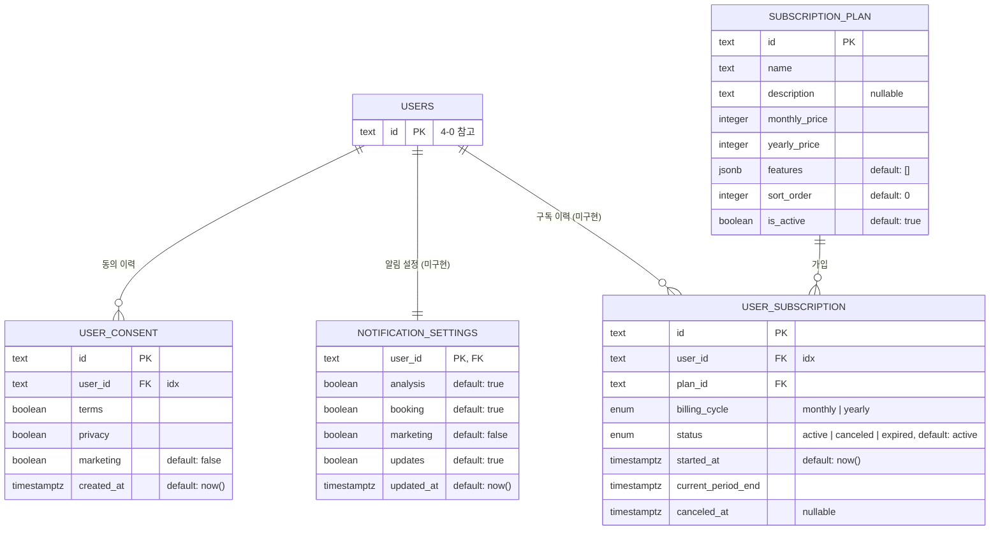
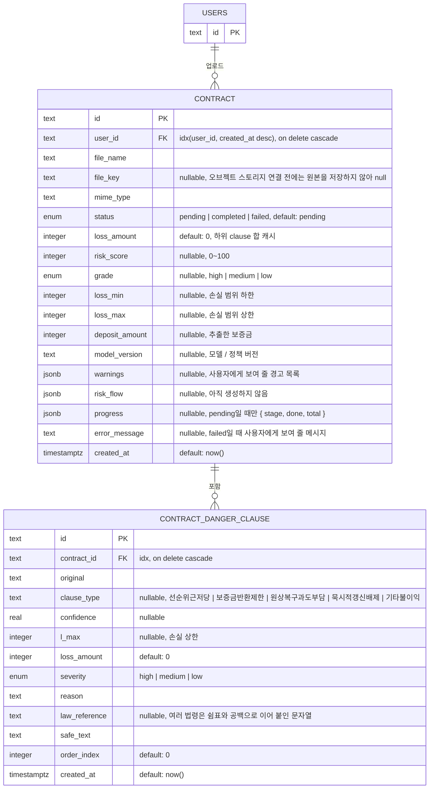
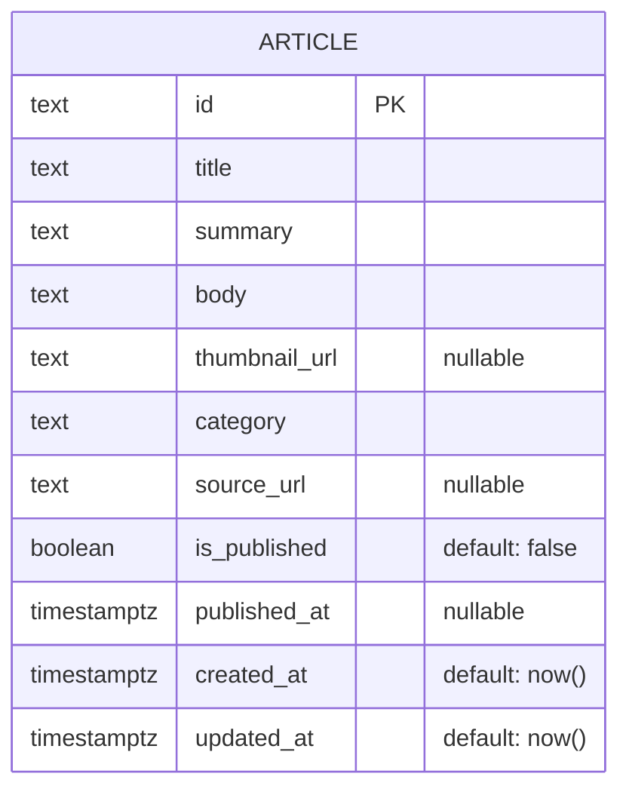
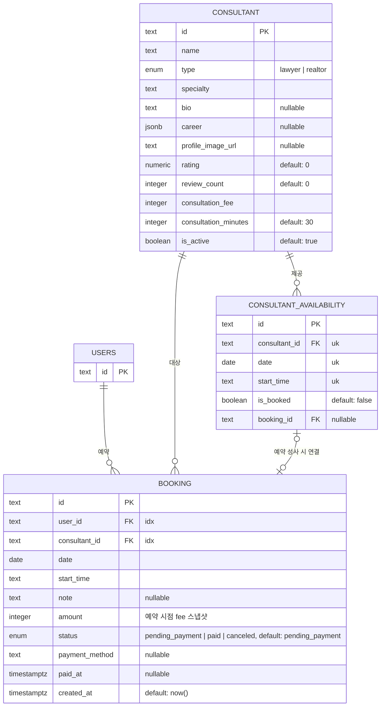

# 4. Data Schema Modeling

[`03-high-level-design.md`](./03-high-level-design.md)의 PostgreSQL에 실제로 들어갈 테이블 구조입니다. 주석 없는 필드는 `NOT NULL`, `nullable`로 표기된 것만 NULL 허용입니다.

> **구현 현황 (2026-10)**: 구현된 테이블은 `users`, `sessions`, `email_codes`, `user_consent`, `contract`, `contract_danger_clause`입니다. **`notification_settings`, 구독, 소식, 상담·예약 테이블은 아직 없습니다**(각 절에 표시). 실제 스키마의 기준은 **`server/internal/database/migrations/`** 이고, 이 문서는 설계 의도를 설명합니다. 마이그레이션은 server가 시작할 때 적용되며(goose) 쿼리 코드는 sqlc로 생성합니다. 시각은 모두 `timestamptz`입니다.

인터랙티브 ERD (설계 당시 기준이라 인증 테이블 등이 현재와 다릅니다): https://claude.ai/artifact/BNsxk821QQ7qSEr93Lbum6

---

## 4-0. 인증 — `users` · `sessions` · `email_codes` (구현됨)

비밀번호가 없는 이메일 인증코드 로그인을 위한 테이블입니다. 이전 설계는 Better Auth가 만드는 `user`·`session`·`account`·`verification`을 전제했지만, 인증을 server가 직접 구현하면서 아래처럼 바뀌었습니다(`account`, `verification`은 없음).

- `sessions` 행을 지우면 세션이 폐기된다(로그아웃, 전체 폐기). access 토큰도 이 행을 확인하므로 폐기 즉시 못 쓴다.
- 만료된 `email_codes`와 `sessions`는 1분마다 도는 청소 작업이 지운다.
- 사용자 ID는 `text`(UUID 문자열)다.

## 4-1. User 확장 — `user_consent` (구현됨) · `notification_settings` · `subscription_plan` · `user_subscription` (미구현)

- `user_consent`는 append-only 이력 (재동의마다 새 행)
- `notification_settings`는 유저당 현재 상태 1행, `user_id`가 PK 겸 FK (1:1)
- `subscription_plan`은 유저와 무관한 공개 카탈로그
- 인덱스: `user_subscription(user_id, status)` — "현재 구독" 조회용

## 4-2. Contract — `contract` · `contract_danger_clause` (구현됨)

- `contract.status`는 **폴링에 쓰는 실제 상태**다. 업로드하면 `pending`(+ `progress`)으로 만들고, 분석이 끝나면 `completed`(결과 저장) 또는 `failed`(`error_message`)가 된다. 분석은 비동기라 클라이언트는 `GET /contracts/{id}`를 폴링한다(02-2-1 "결정 변경 (2026-10-06)").
- 결과(`completed`)는 계약서 행 갱신과 조항 저장을 **한 트랜잭션**으로 한다. 분석하는 동안 사용자가 계약서를 지웠으면(행이 없으면) 결과를 버린다.
- 오래된 `pending`(15분 초과)은 `failed`로 바뀐다(조회 시점과 1분 주기 청소).
- `law_reference`는 지금 법령 여러 개를 `", "`로 이어 붙인 문자열 한 컬럼이다. 상세 조회 응답에는 이 문자열이 그대로, 조항 상세 응답에는 `", "`로 쪼갠 배열이 나간다.
- `monthly_rent`, `lease_type`, `analysis_ms`, `precedent_ids` 같은 06-6-7의 추가 제안 컬럼은 아직 없다.
- `contract.loss_amount`는 하위 `contract_danger_clause.loss_amount` 합을 분석 시점에 캐시
- 인덱스: `contract(user_id, created_at desc)` — 히스토리 페이지네이션용, `contract_danger_clause(contract_id)`

## 4-3. Article (미구현)

- `source_url`은 법적 신뢰도를 위한 출처 표기
- `is_published`/`published_at`으로 검수 전 노출 방지 + 노출 정렬 기준 분리
- 인덱스: `article(is_published, published_at desc)`

## 4-4. Consultant 예약 — `consultant` · `consultant_availability` · `booking` (미구현)

- `booking.amount`는 `consultant.consultation_fee`의 예약 시점 스냅샷 (이후 가격 변경과 무관)
- `booking.status`는 `pending_payment → paid`로만 흐름, `canceled`는 결제 전 이탈
- 유니크: `consultant_availability(consultant_id, date, start_time)` — 슬롯 중복 생성 방지
- 인덱스: `booking(user_id)`, `booking(consultant_id)`

**모델링 제외:** FAQ — DB/API 없이 클라이언트에 하드코딩.

---

## 다음

- 전체 요약: [`05-overview.md`](./05-overview.md)
